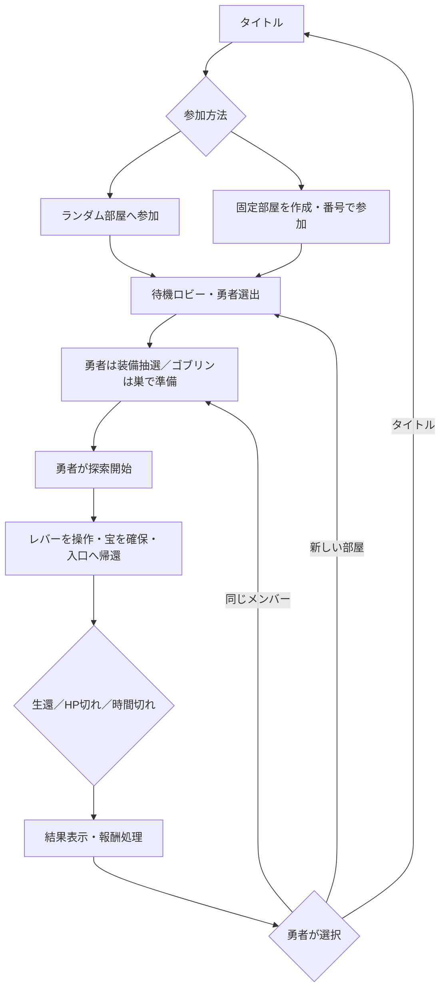
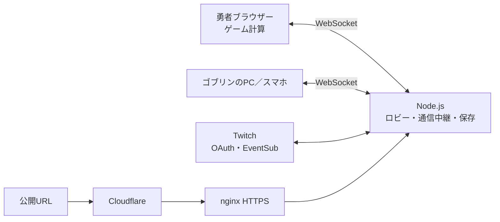

# ゴブリンたち vs 勇者 — ゲーム仕様書

- 作成日：2026年11月2日
- 更新日：2026年11月3日
- 対象：v0.1.12 / build 20261103-063904
- 基準：現在のソースコード。過去の企画案やREADMEと異なる場合は、この版の実装内容を記載する。
- 公開URL：<https://goblin-vs-hero.kitakuarcade.com/party.html>
- 配置状況：v0.1.12の更新アーカイブ作成済み。公開サーバーへの適用状況は別途確認が必要。

## 1. コンセプト

**迷宮で攻守交代。宝を奪って逃げる勇者と、巣を守るゴブリンたちの非対称対戦パーティゲーム。**

勇者「お宝はいただく！」

ゴブリンたち「お前は逃がさん！」

勇者は探索・戦闘・ダッシュ・道具を使い、巣の奥の宝を持って入口へ生還する。ゴブリンは直接操作またはAuto指示で、追跡・投石・鍛錬・進化・抜け道などを使って阻止する。

配信者が勇者を続ける遊び方と、仲間内で勇者を交代する遊び方に対応する。Twitch観客はゲームへの直接参加に加え、チャット投票でイベントを発生させることもできる。

成人向け・性的な演出を扱わず、戦闘は非グロテスクなエフェクトで表現する。

## 2. プラットフォームと人数

| 項目 | 現行仕様 |
| --- | --- |
| 実行環境 | インストール不要のWebブラウザーゲーム |
| 描画 | Three.jsによる3D、ロビーはCanvasによる2D |
| 勇者 | PC・キーボード・マウス推奨。FPS視点 |
| ゴブリン | PCまたはスマホ／タブレット。斜め後ろ上方からの3D追従視点 |
| 正式なパーティ人数 | 最大6人：勇者1人＋人間操作のゴブリン最大5人 |
| 不足する敵 | AIゴブリンで補完。人間参加時にAI個体を置き換える |
| 1人プレイ | 専用の「1人で探索」入口からAI相手に遊べる |
| 接続形態 | 同一LAN内、または公開サーバー経由 |
| Twitch | 任意の追加連携。通常のゲーム参加にTwitchアカウントは必須ではない |

勇者のFPS操作にはPointer Lockを利用する。内蔵ブラウザーなどで許可されない場合は、通常の対応ブラウザーで開く。ゴブリン側は固定が許可されない環境でも右ドラッグで視点を操作できる。

## 3. 入口と部屋

### 3.1 タイトル画面

タイトル・対戦イメージ画像・キャッチコピー・バージョンを表示し、名前を入力して次の入口を選ぶ。

1. **ランダムメンバーで遊ぶ**
2. **固定メンバーで遊ぶ**
3. 補助入口として **1人で探索**

### 3.2 ランダムメンバー

- 参加者を空きのあるランダム部屋に自動振り分けする。
- 固定メンバーの部屋には自動で入れない。
- 2人集まると20秒のカウントダウンを開始する。
- 3人以上になると、残り時間を最大5秒まで短縮する。
- 人数が2人未満になると出発待ちを解除する。
- 勇者候補は「勇者の抽選に参加する」をONにした接続中のメンバー。
- 候補のうち、その部屋で勇者を担当した回数が少ない人を優先し、同数なら抽選する。
- 進行中の部屋にも空きがあればゴブリンとして途中参加できる。
- 終了画面で勇者が選択するまで、自動で次の試合には進まない。

### 3.3 固定メンバー

- 部屋を作成するか、6桁の部屋番号を入力して参加する。
- 番号を知っている人が参加できるプライベート部屋として扱う。
- 通常は途中参加でき、進行中ならゴブリンになる。
- 管理役が待機中に勇者の担当方式を設定する。

| 担当方式 | 内容 |
| --- | --- |
| ラウンドごとに交代 | 担当回数の少ない候補から勇者を選ぶ |
| 指定した人が毎回勇者 | 配信者など、指定メンバーを勇者に固定する |

管理役と、そのラウンドの勇者は別の役割。固定勇者が退出・辞退した場合は、管理役が指定し直す。

部屋番号は招待用コードであり、ユーザーアカウントのパスワードではない。

### 3.4 QR招待

- 固定部屋の待機画面と試合画面から招待QRを開ける。
- QRには `party.html?room=123456` のような部屋番号付きURLを入れる。
- LANではスマホから到達できるPCのLANアドレスを使用する。
- 公開環境では公開URLを使用する。
- 読み取り先では部屋番号を入力済みにし、名前を確認して参加する。
- QRはブラウザー内で生成し、外部のQR生成サービスは利用しない。

### 3.5 待機ロビー

- 洞穴の焚き火を囲む2Dの待機広場を表示する。
- 自分のアバターをクリック／タップ、またはWASD・矢印キーで動かせる。
- 部屋内チャット、定型文「よろしく！」「勇者やる！」「集合！」を使える。
- チャットは最大100文字、直近30件。送信には0.8秒の間隔を設ける。
- 発言は一時的な吹き出しでも表示する。
- 待機広場で動いても、試合中の能力・経験値は増えない。

## 4. ラウンドの流れ



### 4.1 準備

- 勇者は3枠の持ち込み道具を抽選する。
- 初回抽選から30秒間、3枠まとめて何度でも引き直せる。
- 引き直しても30秒の期限は延長されない。
- 期限切れでは最後に引いた装備を保持する。
- 探索開始を押した時点で装備を確定する。
- ゴブリンは勇者の出発前から巣へ入り、移動・鍛錬・食事などを行える。
- 勇者出発時は、ゴブリン側の準備・設定画面を閉じて操作画面へ戻す。

**現状、全員共通の「準備は必ず1分で終了」という制限はない。** 30秒制限は装備の引き直し期間に対するもの。

### 4.2 勝敗

| 結果 | 条件 |
| --- | --- |
| 勇者の勝利 | 宝を確保して、制限時間内に生きて入口へ戻る |
| ゴブリン側の勝利 | 勇者のHPを0にする、または時間切れまで帰還を阻止する |
| 通常パーティの制限時間 | 4分 |
| 1人探索の制限時間 | 7分 |

宝を取るだけではクリアにならない。入口までの帰路もゲームの一部とする。

### 4.3 終了画面

勇者に次の3択を表示する。

| 選択 | 動作 |
| --- | --- |
| 同じメンバーで遊ぶ | 部屋番号・メンバー・勇者固定／交代設定を維持し、次ラウンドの準備へ。新規参加を止める |
| 新たに部屋を作って待機 | 旧部屋を終了して旧メンバーへ通知。選んだ勇者だけを新しい部屋へ移し、新メンバーを募集する |
| タイトルに戻る | 部屋を終了し、タイトルへ戻る |

- 「新たに部屋を作って待機」には「ゴブリンのメンバーを全員入れ替える場合はこちら」と説明を付ける。
- ランダム部屋の新規募集では、直前のゴブリンが直ちに同じ新部屋へ再マッチすることを避ける。
- ゴブリン側には勇者の選択待ちを表示する。自分だけ退出してタイトルへ戻ることもできる。
- 結果の重複受信やボタンの二重操作で、報酬や部屋が重複しないようにする。

## 5. ダンジョン

### 5.1 基本構造

- 現在の舞台は1種類の「ゴブリンの巣」。
- 25×25マス、1マス2ワールド単位。
- 勇者画面では天井・岩壁・鍾乳石・家具で洞穴を表現する。
- 部屋の位置は固定し、ラウンドごとに一部通路の迂回ルートと罠配置を変更する。
- 完全なランダム迷路ではなく、部屋の意味を覚えつつ、毎回同じ経路だけでは済まない構成。

| 部屋 | 用途・特徴 |
| --- | --- |
| 巣の入口 | 勇者の出発点と帰還地点 |
| 見張りの焚き火 | 見張りと分岐のある広間 |
| ゴブリン鍛錬場 | 木人・重り・打ち込み袋。視聴者ゴブリンの出現・復活地点 |
| 食料庫 | 食卓・食料・貯蔵品 |
| ゴブリンの寝床・食堂 | 寝床による回復と食事 |
| 盗品工房・食堂 | 宝物庫の扉を開くレバー、食卓 |
| 骨と罠の広間 | 骨などの障害物と危険な経路 |
| 宝物庫 | 持ち帰る宝の配置場所 |

宝物庫の正面扉は最初は閉じており、勇者は工房のレバーを操作して開ける。

### 5.2 ゴブリン専用経路

- 小さな穴、見つけにくい隠し通路、壁登り用の接続を設ける。
- 勇者は専用経路を通れない。小柄なゴブリン専用の経路である。
- ゴブリンの進化段階によって、穴・壁登りの利用可否が変わる。
- Auto移動は経路探索で専用経路や封鎖穴を扱い、必要なら掘削や壁越えを行う。
- 直接操作の壁登りは、Autoと同じ登攀演出を完全には共有していない。専用の登攀入力・演出統一は改善項目。

### 5.3 穴の封鎖

| 項目 | 値 |
| --- | --- |
| 勇者の封鎖操作 | 近い穴へ照準を合わせてE |
| 封鎖時間 | 30秒 |
| 封鎖のクールダウン | 5秒 |
| 掘削耐久 | 24回 |
| 掘削間隔 | 0.45秒 |

穴の中や入口にゴブリンがいる場合は封鎖できない。すでに封鎖した穴の時間延長はできない。複数ゴブリンの掘削を合算し、耐久がなくなると開通する。

現行の視聴者による掘削は、マップで封鎖穴を指定する指示、およびAuto経路上の処理。直接操作で通常攻撃を連打するだけの掘削操作は未統合。

### 5.4 障害物とジャンプ

- 勇者・直接操作ゴブリンとも、接地中にジャンプできる。
- 二段ジャンプは不可。
- 骨・廃材など高さ0.3の障害物はジャンプして越えたり、上に乗ったりできる。
- 高い家具や壁は、ジャンプしても通過できない。
- 物体の上から離れると地面へ落下する。

### 5.5 罠

通常はラウンドごとに12箇所を選ぶ。入口・レバー・宝の至近や鍛錬場周辺を避け、一定間隔を空けて配置する。

| 種類 | 表示・動作 | 主な対処 |
| --- | --- | --- |
| 棘 | 茶色系。0.7秒の予兆後、0.45秒作動 | ジャンプまたは迂回 |
| 毒胞子 | 緑色系。1.2秒の予兆後、2.2秒噴出 | 範囲から離れる |
| 鳴子 | 黄色系。音を発生させ、AIを調査へ向かわせる | 踏まずに迂回する |

- 再使用までの待ち時間は3秒。
- 棘・毒胞子の基本ダメージは勇者に12。護符で軽減する。
- 棘は発動時に十分な高さまで跳んでいれば回避できる。
- 現状の罠作動・被害判定の対象は勇者。ゴブリンの罠設置・任意起動は未実装。

## 6. 勇者

### 6.1 基本能力

| 項目 | 値 |
| --- | --- |
| 最大HP | 150 |
| 通常移動 | 2.5単位／秒 |
| ダッシュ | 5.0単位／秒（Shift長押し、通常の2倍） |
| 被弾後の共通無敵 | 1.1秒 |
| 標準武器 | 剣と短銃を切り替え可能 |

### 6.2 剣と短銃

| 項目 | 剣 | 短銃 |
| --- | --- | --- |
| 攻撃操作 | 左クリック／長押し | 左クリック／長押し |
| 基本ダメージ | 1 | 2 |
| 攻撃間隔 | 0.32秒 | 0.28秒 |
| 主な制限 | 近距離、1振り中の同じ相手への重複ヒットなし | 装弾6、予備36、射程18、リロード1.6秒 |

- 剣の判定は視線の左右・上下方向を反映する。
- 壁越しに攻撃できない。
- ヒット時は火花・ヒット表示を出す。
- 短銃には反動・マズルフラッシュ・弾道表現を付ける。
- ソウルイーターの討伐回復と砥石の攻撃強化は剣に適用する。

### 6.3 探索マップ

- 右上に半透明の自動マップを表示する。
- 見通しのある周囲を探索済みとして記録し、一度見た場所を保持する。
- 入口は最初から表示する。
- 宝の位置は発見後に表示する。
- 勇者のマップに敵の現在位置や未発見の宝を公開しない。
- ゴブリンの隠し通路を、最初から分かりやすい通路として表示しない。

### 6.4 道具ルーレット

3枠は「回復」「補助」「戦闘」。回復系を必ず1枠保証し、道具店で購入したアイテムを対応する枠の追加候補にできる。

| 基本道具 | 枠 | 効果 | 回数 |
| --- | --- | --- | --- |
| ポーション | 回復 | HP60回復 | 3 |
| 回復リング | 回復 | 行動中、毎秒HP1.5回復 | 常時装備 |
| ソウルイーター | 回復 | 剣による討伐ごとにHP18回復 | 常時装備 |
| 疾風の靴 | 補助 | 12秒間、移動速度1.4倍 | 2 |
| 閃光玉 | 補助 | 近くの見通せる敵を6秒足止め | 2 |
| 守りの護符 | 戦闘 | 12秒間、被ダメージ半減 | 2 |
| 砥石 | 戦闘 | 15秒間、剣の攻撃力2倍 | 2 |

回復は最大HPまで。HP満タン時はポーション等を消費しない。常時装備アイテムは使用キーを押さなくても働く。

## 7. ゴブリン

### 7.1 直接操作とAuto

| 方式 | 内容 |
| --- | --- |
| 直接操作 | WASD・ジョイスティックで移動し、自分で攻撃・投石・ジャンプする |
| Auto | 移動先・鍛錬・同族狩り・勇者追跡・掘削・寝床などを指示する |

- 初期操作方式は直接操作。操作方式の選択はセッション内に保存する。
- 作戦を指示するとAutoへ切り替わる。
- 移動キーや「直接操作に戻る」で手動へ戻れる。
- Auto同族狩りは相手の指定、または近い到達可能な相手の自動選択に対応する。
- AIゴブリンは灰緑色、人間のゴブリンは名前とスカーフ色等で識別する。

### 7.2 視点とUI

- 標準は本人の斜め後ろ上方から追う3D視点。
- 「追従」「近め」「俯瞰」の3種類を切り替えられる。
- マップは補助画面として開閉する。
- 視界を遮らないよう、ゴブリン側の通常壁は高さ0.85、登攀箇所は1.15の固定断面表示にする。勇者側の壁の高さは別。
- 移動距離による壁の急な伸縮はしない。
- HP・経験値・視点・地図・同族殺しを小さく表示し、成長・作戦・報酬・設定はメニューにまとめる。
- モバイルは左下にジョイスティック、右下に半透明の攻撃・ジャンプ、その上に投石ボタンを配置する。
- 食料に近づき、HPが減っている場合だけ食べるボタンを出す。
- 操作メニューや地図を開いたとき、移動・攻撃の押しっぱなしを解除する。

### 7.3 近接攻撃と投石

- 直接操作の近接攻撃はカメラの水平方向を反映する。真後ろの敵に自動では当たらない。
- 近距離かつ見通せる相手を判定し、射程は約1.4単位。
- 同族への攻撃間隔は基本0.8秒。勇者へのヒット後は1.2秒。
- 短いクリックを定期通信の隙間で失わないよう、単発攻撃も送信する。

| 投石の項目 | 値 |
| --- | --- |
| 操作 | 2キー、画面の投石ボタン |
| クールダウン | 5秒 |
| 速度／射程 | 7単位／秒、9単位 |
| ダメージ | 勇者6、同族2 |
| 同族への追加効果 | 短いひるみ |
| 壁・回避 | 壁で止まり、移動して避けられる |

通常は視点の前方へ投げる。同族殺しONで相手を選択している場合は、その相手の方向へ投げる。

### 7.4 同族殺しトグル

- 初期状態は **OFF**。
- Fキーまたは「同族殺し ON／OFF」ボタンで切り替える。
- OFF：近接攻撃と投石で同族を傷つけない。Auto同族狩りを停止・禁止する。
- ON：同族も攻撃対象にできる。勇者への攻撃は引き続き可能。
- メニューから明示的に「選んだ仲間を襲う」を押すと、ONにしてAuto同族狩りを指示する。
- 子ゴブリンの同族保護はONでも解除されない。
- OFFは「自分から同族へ攻撃しない」という設定であり、他人の同族攻撃や既に敵対したAIから無敵になる設定ではない。
- 判定は勇者側のゲーム計算で行い、表示だけでダメージを切り替えない。

### 7.5 成長と進化

進化は任意。経験値が条件に達したら進化画面から実行する。

| 形態 | 必要なラウンドEXP | 最大HP | 基礎近接ダメージ | 移動速度 | 小穴 | 壁登り |
| --- | ---: | ---: | ---: | ---: | --- | --- |
| ゴブリン | 0 | 6 | 1 | 1.6 | 可 | 可 |
| ホブゴブリン | 30 | 10 | 2 | 1.85 | 不可 | 可 |
| ゴブリン・キング | 90 | 16 | 3 | 2.1 | 不可 | 不可 |
| ゴブリン・ロード | 180 | 22 | 5 | 2.35 | 不可 | 不可 |

- 表の基礎近接ダメージは同族向け。勇者への近接攻撃は基礎値の3倍。
- 進化すると大型化し、ロードは暗黒騎士の外観になる。
- 進化すると攻撃力・HP・移動速度が上がる。専用経路の自由度は下がる。
- 進化時は現在HPの割合を維持する。
- 進化後に通れない穴の中など、帰路を失う場所では進化できない。
- Shift長押しのダッシュは各形態の通常速度の2倍。スニークと移動キー2回押しのダッシュは廃止。

| EXP獲得手段 | 現行値・条件 |
| --- | --- |
| 鍛錬 | 設備で4秒継続すると+6 EXP。その後2秒休憩 |
| 同族討伐 | +18 EXP。同じ相手からの獲得は60秒に1回 |
| 指示による穴掘り完了 | +8 EXP。重複の作業実績は制限 |
| ラウンド終了参加報酬 | +10 EXP相当の功績処理。重複付与しない |

鍛錬設備は木人・重り・打ち込み袋。設備まで自動移動し、他メンバーが使用中なら別の設備を選ぶ。勇者が近くに見える場合や、行動の中断によって訓練は止まる。

### 7.6 死亡と子ゴブリン

1. 死亡後、10秒待つ。
2. 鍛錬場でHP3の子ゴブリンとして復活する。
3. 子ゴブリン期間は20秒。
4. 死亡前から1段階下の形態へ成長する。通常ゴブリンより下には下がらない。

- 成長時のEXPは、その段階の開始値になる。HPは成長先の最大値になる。
- 子ゴブリンは同族に狩られず、自分からも同族を狩れない。
- 子ゴブリン期間は鍛錬・進化ができない。
- 移動・ジャンプ・弱い勇者攻撃・掘削等は可能。子ゴブリンの掘削にEXPは付かない。
- 勇者からは倒される。
- 子ゴブリン期間に再死亡しても、成長予定の段階を追加では下げない。
- 専用の「ゴブリンのゆりかご」部屋は未実装。現状は鍛錬場を復活地点に使う。

## 8. 食事と寝床

### 8.1 食料

食料庫・寝床の食堂・工房の食堂の3卓に、それぞれリンゴ・パイ・ご飯を置く。合計9個を勇者とゴブリンで共有する。

| 食料 | 勇者のHP回復 | ゴブリンのHP回復 |
| --- | ---: | ---: |
| リンゴ | 20 | 2 |
| パイ | 35 | 4 |
| ご飯 | 25 | 3 |

- 食料へ近づき、Eまたは食べるボタンで使用する。
- 食べられた物は全員の画面からなくなる。
- 同じ食料を複数人が重複取得できない。
- 満タン時・死亡中・離れた場所・壁越しでは食べられない。
- 新しいラウンドで補充する。時間経過による再補充はない。

### 8.2 ゴブリンの寝床回復

- 寝床の上で1秒落ち着くと、毎秒0.5、つまり2秒でHP1を回復する。
- 各形態の最大HPまで回復する。
- 攻撃・被弾後は3秒間、回復を待つ。
- 寝床から離れる、死亡する、空中にいる、試合が終了すると回復しない。
- Autoの「寝床へ」で移動と休息を指示できる。
- 勇者には寝床の自動回復を適用しない。

## 9. AIゴブリン

- 常に勇者へ向かう挙動にはしない。
- 待機、近隣の巡回、疑い、音の調査、追跡、捜索、持ち場への帰還を切り替える。
- 待機中も呼吸・首振り・周囲を見回す動きを出す。
- 見通しと向きで発見を判定する。
- 通常の発見距離は7.5。変装時には発見を抑える処理が残るが、Shiftによるスニークは廃止した。
- 至近距離では背後でも気づくことがある。
- 足音・走行・剣・銃声・鳴子・投げ石等を聞いて、その位置を調査する。
- 視界を失った後は最後に認識した場所を追い、捜索してから戻る。
- ダメージを受けたAIは反応する。同族に攻撃された場合は反撃する。
- 宝を取っただけで、全AIが勇者の現在位置を知ることはない。
- 通常AIのHPは3、死亡後の復活待ちは22秒。

## 10. 持ち越し報酬

### 10.1 勇者の金貨・宝物庫

- 生還で60金貨と宝1種類を獲得する。
- 既に持っている宝なら追加25金貨、合計85金貨。
- 失敗時は金貨・展示品を獲得せず、見つけた宝の発見記録だけを保持する。
- 宝は12種類。重複しない展示数で収集率を計算する。

| レアリティ | 宝 |
| --- | --- |
| common | 銅の小像、骨のさいころ、欠けた銀杯、琥珀の虫 |
| uncommon | 月の古銭、紅玉の義眼、盗まれたオルゴール、翡翠の牙 |
| rare | 星読みの羅針盤、失われた王印、黒竜の鱗 |
| legendary | 夜明けなき王冠 |

抽選重みは各宝につきcommon=6、uncommon=4、rare=2、legendary=1。

### 10.2 道具店

| 道具 | 金貨 | 必要収集率 | 効果 |
| --- | ---: | ---: | --- |
| 薬草包帯 | 80 | 0% | HP25回復×4回。回復枠の候補 |
| 投げ石袋 | 100 | 25%（3種） | 音でAIを誘導×4回。補助枠の候補 |
| ゴブリン変装セット | 160 | 50%（6種） | 15秒間AIに気づかれにくい×2回。戦闘枠の候補 |
| 身代わり人形 | 220 | 75%（9種） | 10秒間、姿と音でAIを引きつける×2回。補助枠の候補 |

- 収集率で購入権を解放し、金貨で購入する。
- 購入した道具は以後のルーレット候補へ追加できる。
- 候補に含めるかをチェックで選択できる。購入したから必ず持ち込めるわけではない。
- 変装は走行・攻撃・AIへの接近等で解除される。
- 囮はAIの認識に働きかける。人間ゴブリンの判断を強制しない。

### 10.3 ゴブリンの累計功績

ラウンドEXPと累計功績を分ける。ラウンドEXP・進化は試合ごとにリセットし、累計功績は保存する。

- 累計への加算は1試合60まで。
- 上限後も、その試合内でのEXP獲得は続けられる。
- 現行の恒久報酬は称号とスカーフ色。基本能力は増加しない。

| 称号 | 条件 |
| --- | --- |
| 巣の新入り | 初期 |
| 鍛錬好き | 累計で記録された鍛錬5回 |
| 同族狩り | 累計で記録された同族討伐3回 |
| 穴掘り名人 | 累計で記録された作業3回 |
| 巣の古参 | 累計功績100 |
| 暗黒騎士への道 | ロードまで進化した実績 |

功績で能力装備・エモートを購入する店、進化段階ごとの初回ボーナス、勇者討伐の貢献度配分、罠への誘導報酬は、現状の実装には含まれない。

## 11. 操作一覧

### 11.1 PCの共通操作

| 操作 | 勇者 | 直接操作ゴブリン |
| --- | --- | --- |
| WASD／矢印 | 視点基準の移動 | 視点基準の移動 |
| 左クリック | 剣・短銃の攻撃 | 近接攻撃 |
| Space | ジャンプ | ジャンプ |
| Shift長押し | ダッシュ（通常の2倍速） | ダッシュ（通常の2倍速） |
| マウス移動 | Pointer Lock中の視点操作 | Pointer Lock中の視点操作 |
| E | 食事、レバー操作、穴の封鎖 | 近くの食料を食べる |
| Esc | カーソル固定解除・準備／休止画面 | 固定解除、地図・メニューを閉じる。操作画面ではメニューを開き、再度押すと閉じる |
| N | 音のON／OFF | 音のON／OFF |

Shiftを離す、移動を止める、入力をクリアするとダッシュを解除する。移動キーの2回押しではダッシュしない。Ctrlは移動操作に使わない。

### 11.2 役割固有のキー

| キー | 勇者 | ゴブリン |
| --- | --- | --- |
| Q | 剣／短銃の切替 | 割当なし |
| R | 短銃をリロード | 割当なし |
| 1・2・3 | 持ち込み道具の各枠を使用 | 2のみ投石 |
| F | 割当なし | 同族殺しON／OFF |
| V | 割当なし | 追従／近め／俯瞰の切替 |
| M | 自動マップを常時表示 | 補助マップの開閉 |
| Tab | 専用割当なし | メニューを開く。メニュー内では項目間のフォーカス移動 |
| G | 割当なし | 進化画面を開く |
| 右ドラッグ | 専用割当なし | カーソル固定を使わない視点操作 |

文字入力中はゲームのショートカットを実行しない。メニュー表示中は戦闘入力を停止する。

### 11.3 タッチ操作

- 左下のスティック：倒した方向と量で移動。中央にデッドゾーンを設け、斜め移動が速くなりすぎないようにする。
- 右下の攻撃：押すと攻撃、保持するとクールダウンに従って繰り返す。
- 「跳ぶ」：ジャンプ。
- 投石：5秒CDの技。
- 画面ドラッグ：視点変更。
- 同族殺し・視点・地図・メニュー・食事は画面ボタンから操作する。
- 移動と攻撃は別の指で同時操作できるよう、ポインターごとに状態を分ける。
- 現状、スマホ専用のダッシュボタンは設けていない。

## 12. Twitch連携

### 12.1 利用者と権限

- ゲームサーバー管理者がTwitchアプリのClient ID・Client Secret・公開URLを設定する。
- 各配信者が自分のTwitchアカウントで、自分のチャット読み取りを認可する。
- 特定の開発者・配信者だけに利用者を固定しない。
- 固定部屋の管理役が待機中に「自分のTwitchと連携」から認可を開始する。
- 連携は部屋単位で扱い、別配信者のチャット・投票が混ざらないようにする。
- Twitchチャットの読み取り権限は `user:read:chat`。EventSub WebSocketを利用する。
- Twitchアカウントで一般の参加者全員を識別・ログインさせる仕組みではない。

### 12.2 観客投票

連携した配信者が、探索中に20秒の投票を開始する。観客はTwitchチャットに半角の `1`、`2`、`3` を送る。

| 番号 | イベント | 効果 |
| --- | --- | --- |
| 1 | 暗闇 | 勇者の視界を8秒間暗くする |
| 2 | 騒音 | 勇者の位置で大きな音を発生させ、AIゴブリンをおびき寄せる |
| 3 | 差し入れ | 生きているゴブリンをHP2回復。最大HPまで |

- 1人1票。期間内に送り直すと最後の選択へ変更する。
- 最多得票を採用し、同票なら抽選する。
- 0票なら何も起こさない。
- 投票開始から次の開始までは60秒以上空ける。
- ラウンド終了で未確定投票をキャンセルする。
- イベントIDで重複適用を防止し、通知・暗転は時間経過で解除する。
- 死亡したゴブリンを差し入れで蘇生しない。
- 参加費・サブスク・Bitsは要求しない。

部屋を終了して新しい部屋へ移る場合は、その新しい部屋でTwitch連携を行う。サーバー再起動時も連携状態は失われる。

## 13. キャラクターとアニメーション

| アセット | 現在の利用 |
| --- | --- |
| 勇者 | ゴブリン画面等で表示。本人のFPS画面では一人称用の武器表現 |
| AIゴブリン | NPCとして出現 |
| 視聴者ゴブリン | 人間参加時の通常形態 |
| 子ゴブリン | 死亡後の復活形態 |
| ホブゴブリン | 進化形態 |
| ゴブリン・キング | 進化形態 |
| ゴブリン・ロード | 暗黒騎士の最終進化形態 |
| サイクロプス | GLBとアニメーション確認画面あり。実際の対戦への出現・行動は未実装 |

- GLBはリグ付きモデルを使用する。
- サイクロプス由来のパンチモーションを、各ゴブリンのボーン回転へ変換して共有する。
- ボーンの長さやワールド座標を上書きせず、形態ごとの体型を維持する。
- 歩行・走行はゲームの移動量とモデル内部の水平移動を重複させない。
- ホブ・ロード等の座りモーションはプレビューに存在するが、ゲーム中の任意の着席・寝床休息アニメーションへ全面統合はしていない。
- 確認用ページは `character-preview.html?model=...`。

## 14. ID・保存・再接続

### 14.1 参加者ID

- ブラウザー内に生成・保存したランダムな端末IDを使用する。
- 表示名・勇者／ゴブリンの役割が変わっても、同じIDを使う。
- ハードウェア固有IDではない。
- 別ブラウザー、別オリジン、保存データ消去では別IDになる。
- `localhost`、LAN IP、公開ドメインは別の保存先になる。

### 14.2 保存先

| 情報 | 保存先・寿命 |
| --- | --- |
| 勇者の金貨・宝物庫・購入済み道具 | 本人のブラウザーlocalStorage |
| ゴブリン累計功績 | サーバーの `data/goblin-careers.json`。ホスト側にもブラウザー保存処理あり |
| 名前・参加者ID | ブラウザー保存 |
| 部屋復帰情報・操作方式 | ブラウザーのセッション保存等 |
| 部屋・進行中の試合・ラウンドEXP | 実行中メモリー。永続復元しない |
| Twitch認可・部屋連携 | サーバーメモリー。現行の有効期間は最大12時間 |

ゴブリン累計功績はサーバーから次の勇者へ渡すため、同じサーバー内で勇者を交代しても持ち越す。

### 14.3 スリープ・切断

- ゴブリンの一時切断は即退出とせず、90秒の復帰猶予を持たせる。
- 同じIDで戻れば、その個体・役割・EXP等を引き継ぐ。
- 直接操作中の切断では移動を止める。Auto命令は残る場合がある。
- 明示的な退出は、一時切断とは区別する。
- 猶予を過ぎると参加枠を解除する。
- 勇者ブラウザーはゲーム計算を担当するため、退出や完全な再読み込みで試合継続に影響する。勇者の自動ホスト移行はない。

## 15. 通信・配信構成



- ロビー・マッチング・役割決定はNode.jsサーバーが管理する。
- 移動・戦闘・AI・HP・食料・成長などの試合計算は勇者ブラウザーが担当する。
- ゴブリンは入力や命令を送信し、ホストからの状態を描画する。
- 通常の状態配信は約10Hz、ゴブリンの連続操作送信は約20Hz。
- 対応ホストにはサーバーから20Hzの更新通知を送る。非表示時は通信イベントでも計算を進め、描画を省略する。ブラウザーの完全凍結・破棄やOSのスリープには対応せず、サーバーでの試合計算へ移行したわけではない。
- 接続を失った操作は一定時間で停止し、入力が永遠に残らないようにする。
- サーバー側は同時32部屋までの上限を持つ。実運用の性能保証人数を意味する値ではない。
- 試合計算をサーバーへ全面移管した構成ではなく、競技用の厳密な不正防止は未整備。

| 接続先 | 用途 |
| --- | --- |
| `/party.html` | タイトル、集合ロビー、役割別画面への入口 |
| `/index.html?solo=1` | 1人探索 |
| `/goblin.html` | ゴブリン操作画面 |
| `/lobby` | ロビーWebSocket |
| `/party` | 試合中継WebSocket |
| `/api/lan-info` | 招待先アドレス取得 |
| `/api/twitch/status` | Twitch接続・投票状態 |
| `/auth/twitch/start`・`/auth/twitch/callback` | Twitch認可 |
| `/healthz` | サーバー稼働確認 |

公開構成はCloudflareのサブドメインからnginxを経由し、アプリの `127.0.0.1:8788` へ転送する。Twitch専用のゲームサーバーを別に用意する方式ではない。

## 16. 起動・更新

### 開発

```bash
npm install
npm run dev
```

通常は5173番で起動する。LANから利用する場合は、端末間の到達性とホスト側の受信許可が必要。

### ビルド・自動確認

```bash
npm run build
node --test --test-timeout=20000 scripts/*.test.mjs
```

### 公開サーバーの更新

`output/deploy/goblin-vs-hero-latest.tar.gz` をサーバーの `/opt/goblin-vs-hero-latest.tar.gz` へ転送して実行する。

```bash
/opt/goblin-vs-hero/runtime/bin/node \
  /opt/goblin-vs-hero/deploy/update.mjs \
  /opt/goblin-vs-hero-latest.tar.gz
```

- 更新用ツールはステージング・事前確認・バックアップ・切替後確認を行い、失敗時は旧版への復旧を試みる。
- `data`、アプリ専用Nodeランタイム、設定を保持する。
- 更新時は進行中の部屋・試合が終了する。
- このゲームのディレクトリ全体を削除して更新する運用にはしない。
- 詳細手順は `deploy/README-ja.md`、Twitch設定は `deploy/TWITCH-ja.md` を参照する。ただし過去の検証件数・実装状況の記載は本仕様書の日付と区別する。

## 17. 実装範囲と今後の候補

以下は相談・アセット制作済みのものを含むが、v0.1.9の完成機能として扱わない。

| 項目 | 状況 |
| --- | --- |
| サイクロプスの対戦出現・特殊行動 | モデル・プレビューのみ |
| 廃坑・古城など別種類の巣 | 未実装。一部の旧ホスト設定画面には無効な候補表示がある |
| 全員共通の60秒準備タイマー | 未実装 |
| ゴブリンによる罠の設置・起動 | 未実装 |
| 近くの仲間とのゲーム内ゴブリン語チャット | 未実装。現在のチャットは待機ロビー内 |
| 勇者討伐貢献度・罠誘導のポイント配分 | 未実装 |
| ラウンド内の初回進化ボーナス | 未実装 |
| 功績ショップ、ハチマキ、韋駄天の靴、エモート購入 | 未実装。現在のゴブリン恒久報酬は称号と色 |
| ゴブリン装備枠・装備数制限 | 購入装備システム自体が未実装 |
| 専用のゆりかご部屋 | 未実装。鍛錬場で復活 |
| 通常攻撃連打による穴掘りへの統一 | 未実装。掘削指示／Autoを使用 |
| 全参加者のTwitchアカウントログイン | 未実装。配信者のチャット連携とは別 |
| 複数端末間の勇者セーブ共有 | 未実装 |
| 勇者が落ちても続くホスト移行 | 未実装 |
| サーバー再起動後の部屋・試合復元 | 未実装 |
| 難易度選択・大人数向け性能保証 | 未整備 |

## 18. v0.1.9時点の検証記録

- ビルド成功、自動テスト106件成功。
- HTTP配信、試合WebSocket、ロビー／チャットのスモーク確認成功。
- 実GLBの歩行を繰り返し再生し、水平の巻き戻りがなく、上下動を保持することを確認。
- ジャンプ・着地・二段ジャンプ防止・骨の乗り越え・壁の通行不可・寝床回復との両立をテスト。
- 同族殺しOFF／ON、投石の同族保護、単発クリックと攻撃間隔をテスト。
- 実ブラウザーでW移動、Space、F、V、M、Tab、左クリックのダメージ切替、390px幅のジャンプボタンを確認。
- スマホ実機での操作、今回の公開サーバー配置、最大人数での長時間性能は未確認。
- 勇者のPointer Lockを含む全面的な実プレイ検証と、ゴブリンのPointer Lock成功経路は今回の確認範囲外。

### 18.1 言語対応

- 初期言語は英語。ブラウザーのOS言語に関係なく、設定がなければ `en`。
- 英語（English）／日本語をタイトル・ロビーのヘッダーで切り替える。単独勇者の準備画面とゴブリンの設定メニューにも切り替えを用意。
- 選択は端末のブラウザーに `gg-language` として保存。同じオリジンのタブ・ゲーム用iframeにも反映する。保存できない場合でも、そのページ内では切り替え可能。
- 切り替えによるページ再読み込みは行わない。部屋、役割、位置、HP、EXP、装備抽選と残り時間を維持する。
- タイトル、ロビー、装備ルーレット、道具店、操作説明、通知、ゴブリンの進化・作戦・報酬、地図・3D看板、Twitch投票・認可成功画面・認可エラーを翻訳。
- ユーザーが付けた名前と自由入力チャットは翻訳しない。定型チャットは送信者の選択言語で送る。
- 保存データ・通信コマンド・アイテムIDは言語に依存しない。通知は表示側で翻訳するため、参加者ごとに異なる言語を選べる。
- ブラウザーで英語⇔日本語、同一部屋・日本語名とチャットの維持、勇者iframeの抽選結果、ゴブリン移動後の位置・HP維持、390pxの操作画面を確認。実機スマホと公開サーバーの更新は未実施。

## 19. 主な実装ファイル

| 分野 | ファイル |
| --- | --- |
| 勇者の試合進行 | `src/main.js` |
| 勇者の操作 | `src/controls.js`、`src/movement.js`、`src/jump.js` |
| 地形・経路 | `src/dungeon.js`、`src/nest-art.js` |
| AI・罠・穴 | `src/goblin-ai.js`、`src/traps.js`、`src/burrows.js` |
| ルーレット・勇者報酬 | `src/expedition.js`、`src/loadout-draft.js`、`src/hero-career.js` |
| ゴブリンの試合計算 | `src/local-session.js`、`src/goblin-life.js`、`src/progression.js` |
| ゴブリンの表示・入力 | `src/goblin-view.js`、`src/goblin-world.js`、`src/goblin-controls.js`、`src/touch-controls.js` |
| アニメーション | `src/goblin-motion.js`、`src/in-place-motion.js`、`src/goblin-attack.js` |
| 食事・寝床 | `src/food.js`、`src/goblin-rest.js` |
| ロビー・終了画面 | `src/party-lobby.js`、`src/hideout.js`、`src/round-end.js`、`server/lobby.js` |
| 通信・保存 | `src/party-network.js`、`server/party-relay.js`、`server/career-store.js` |
| Twitch | `server/twitch.js`、`server/twitch-chat.js`、`src/twitch-panel.js`、`src/twitch-effects.js` |
| 言語・翻訳 | `src/i18n.js`、`src/locale.js`、`src/i18n-core.js`、`src/i18n-messages.json` |
| 本番配信・更新 | `server/production.js`、`deploy/` |
| 開発経緯 | `docs/codex-development-log.md` |

本書の数値は現行の調整値。バランス変更時は、該当ソースと本書を同時に更新する。


## 21. v0.1.9の操作・演出の補足

- ソロは部屋コード・ホスト設定・招待を表示せず、通信部屋も作成しない。装備抽選から出発し、終了時は「もう一度探索する」「タイトルに戻る」を選ぶ。対戦の結果画面は従来の3択を維持する。
- Eキーで近くの食料を食べる。ゴブリンの食事ボタンにもEを表示し、クリック・タップと共通の処理を使う。
- 直接操作のゴブリンは横・後ろ・斜めを含む移動方向へ体を向け、停止後は向きを維持する。カメラは自動で回さず、近接攻撃の狙いはカメラ方向のまま。
- 両陣営に音ON／OFFボタンとNキーを用意し、設定を端末に保存する。攻撃の風切り音とHP減少時の打撃音を合成する。12m以上離れた戦闘、初回・長い中断後の状態受信では鳴らさない。初回のクリック・キー操作後にブラウザーの音声を有効化する。
- AIゴブリンは討伐後22秒でHP3に戻り、元の出現位置に復活する。準備中にも復活時間が進む。視聴者ゴブリンは従来の10秒後の子ゴブリン復活を維持する。
- ゴブリンの討伐演出は、約0.55秒の転倒、約1.1秒までの横たわる時間、その後の地面への吸収で構成し、約2.8秒で非表示になる。討伐直後から当たり判定・攻撃対象を外し、復活時に姿勢を復元する。
- 追加の確認：ソロの通信隔離、Eの食事、移動方向と攻撃方向、音の状態検出、通信駆動の背景ホスト、Escの二重処理防止、AIの連続討伐・復活。実画面でもE回復、A／D方向転換、音設定の保持、Esc後の移動復帰、AI討伐・復活を確認した。実機の音の試聴、実機スマホ、長時間の最小化は未確認。


## 22. キャラクター同士の接触（v0.1.9）

- 生きている勇者・AIゴブリン・視聴者ゴブリン同士に当たり判定を持つ。体の半径は勇者0.3、通常ゴブリン0.23を基準とし、子ゴブリンと進化後は体格に合わせて0.17〜0.38に調整する。
- 高さも判定し、ジャンプで相手の体より上に抜ければ通れる。着地や進化で重なった体は壁を越えない範囲で離す。専用の壁登り中は通常歩行の接触処理から外す。
- 移動を小さく分割し、ダッシュ中のすり抜けを防ぐ。接触した方向は止まるが、相手から離れたり横へ抜けたりできる。死体は通行を妨げない。
- 参加・復活時は近くの空き位置を優先する。混雑した狭い通路はキャラクターに塞がれることがある。
- 移動・接触は勇者側の共通計算で確定し、ゴブリン画面は共有された位置を描画する。
- BGMは次節のとおりv0.1.10で実装。


## 23. 場面に応じたBGM（v0.1.10）

- 提供された3曲を `assets/audio/` に配置。タイトル・ロビー・準備・試合終了は `bgm-lobby.mp3`、冒険中は `bgm-dungeon.mp3`、宝の確保後は `bgm-escape.mp3` を再生する。
- 曲は繰り返し再生し、場面切り替えでは旧曲を約0.6秒、新曲を約0.8秒でクロスフェードする。音源自体の編集や曲末の継ぎ目の除去は行っていない。
- 最初のクリック・タップ・キー操作で音声を有効化する。タイトル右下と両陣営の音ON／OFFボタン、NキーでBGM・効果音をまとめて切り替える。設定を端末に保存する。
- 非表示のページでは音を止め、復帰時には最新の場面の曲を再開する。対戦では親ページがBGMを担当し、埋め込みゲームから場面を通知して二重再生を防ぐ。単独の勇者・ゴブリン画面では各ページが担当する。
- MP3をストリーミング再生し、製品サーバーは音声のMIMEとバイト範囲要求に対応する。
- 全111テストとビルド、HTTP・ゲーム通信・ロビーチャットの確認が成功。ブラウザーで3曲の再生時間進行・音声信号・場面変更・消音と再開を確認。タイトルの音設定は再読み込み後も保持された。実機スピーカーでの試聴、スマホ実機、勇者の全行程のプレイ確認、公開サーバーへの配置は未実施。


## 24. AUTO切り替えとレバーの修正（v0.1.11）

- 操作方式でAUTOを選ぶと待機命令ではなく自動行動を開始する。準備中は空いている到達可能な訓練設備へ移動し、冒険開始後は勇者を追跡・攻撃する。子ゴブリンや設備満員時は訓練場周辺を巡回する。
- HPが最大値の35％以下なら到達可能な寝床へ移動し、85％以上まで回復したら通常行動へ戻る。自動の同族狩りや進化は行わない。
- 個別の待機・移動・訓練・休息・狩りなどの指示は自動判断より優先される。WASDで直接操作へ戻る。AUTO設定は再戦・復活後も維持し、子ゴブリンの訓練禁止は守る。
- 抜け穴の経路計算を開口方向に限定し、穴の側壁へ進もうとして足踏みする問題を修正した。
- 宝物庫の開閉レバーは棒と丸い先端を同じ親オブジェクトに入れ、台座上を軸に回す。操作時・リセット時とも丸い先端が棒に追従する。
- 全117テストとビルド、HTTP・ゲーム通信・ロビーチャットの確認が成功。ブラウザーの実ゴブリン画面で直接操作からAUTOへ切り替え、12経験値の獲得、冒険開始後の追跡と攻撃、Aキーでの直接操作復帰を確認した。レバーの両角度で丸い先端と棒先端の座標が一致することを描画付きで確認した。実機スマホ・完全な勇者プレイ・公開サーバー配置は未実施。


## 25. 死亡・復活時の操作方式保持（v0.1.12）

- 死亡待ち中のクリック・移動・ジャンプ・タッチ攻撃では直接操作へ切り替えない。メニューやカメラ操作は利用可能。
- 死亡と復活を受信した際に、保持中のキー・攻撃・タッチ入力を消去する。死亡中から続くキーの自動リピートは復活後も無視し、離して押し直した入力だけを受け付ける。Shift単独ではAUTOを解除しない。
- 再接続時にホスト側の自動行動が有効なら、画面もAUTOに揃える。復活後に新たに移動や攻撃を行った場合は、従来どおり直接操作へ切り替えられる。
- 全119テスト、ビルド、HTTP・ゲーム通信・ロビーチャットの確認が成功。実ゴブリン画面で死亡中のクリック・W・Space、復活後のAUTO自動移動を確認。スマホ実機と公開サーバーへの配置は未実施。
